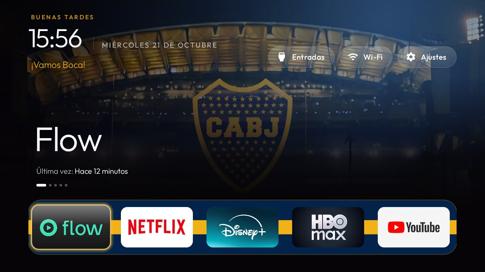

# Boca theme (blue and gold)



A theme in the colours of Boca Juniors: navy background, gold focus, greeting and home message, a blue
dock band crossed by a gold stripe like the one on the shirt, and a cinematic shelf that always glows
in blue instead of each app's colour. Messages under the clock are in Spanish and change
every time Home comes back.

```powershell
powershell -ExecutionPolicy Bypass -File tools\theme.ps1 -TvHost <tv ip> themes\boca
```

It uses keys added in this fork (`accent_color`, `tile_color`, `dock_color`, `cinematic_tint`,
`dock_stripe`, `cinematic_artwork`, `dock_bottom_room`, `home_messages`), so build and install the
launcher from this fork first. They are documented in [../README.md](../README.md).

## Wallpapers

Six example wallpapers ship in `wallpapers/` and rotate every 30 minutes (`wallpaper_rotation_minutes`):
the crest on navy, the trophy cabinet, La Bombonera at night and from above, and two of Riquelme. They are
already adapted: 1280×720, under 300 KB, the area behind the clock darkened. Add, swap or delete any of
them; the launcher shows whatever is in the folder (up to 100) and falls back to the navy background
when it is empty.

To add your own photos, use the tool in this fork instead of resizing by hand:

1. Put the pictures in `themes/boca/originals/` (ignored by git), any name, any size.
2. Run `python tools/prepare_wallpapers.py themes/boca/originals themes/boca/wallpapers`.
   It crops each one to 16:9, scales it to 1280×720, darkens the area behind the clock and the home
   message just as much as that picture needs, compresses it under 300 KB, gives it a file name the
   launcher accepts, and skips pictures smaller than the screen. `--size 1920x1080` for a 1080p UI.
3. Push the theme again.

The example photos are fan wallpapers of Club Atlético Boca Juniors material; crests, photos and
designs belong to the club and to their photographers. They are here only as examples for this theme,
not for redistribution. If you own one of them and want it removed, open an issue and it will be taken
down.

## Your own messages

Copy the folder to `local/themes/boca/` (ignored by git), change `home_messages` (and the photos) there
and push that folder instead: `tools\theme.ps1 -TvHost <tv ip> local\themes\boca`. Personal messages
and photos never end up in a commit that way.
